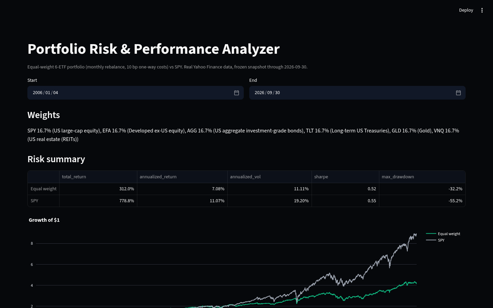

# Portfolio Risk & Performance Analyzer

**Question:** how does a diversified ETF portfolio compare with an equity benchmark (SPY) in return, risk and drawdowns?

Stage 1 of a staged build: real data pipeline → SQLite → equal-weight portfolio vs SPY → Streamlit dashboard. (Minimum-variance optimisation comes in stage 2.)



## Setup
```bash
python -m venv .venv && . .venv/bin/activate
make install      # pip install -e ".[dev]"
make all          # build SQLite, recompute results, ruff, pytest
make app          # streamlit run app/streamlit_app.py
```
The price snapshot in `data/raw/` is frozen and verified against `data/manifest.json` (SHA-256). `make data` re-downloads it, which will change the hashes.

## Data
- **Source:** Yahoo Finance via `yfinance` (`auto_adjust=False`), daily, 2006-01-03 to 2026-09-30, downloaded 2026-10-23.
- **Adjustments:** returns use `Adj Close`, which Yahoo back-adjusts for splits and cash distributions, so a return is a *total* return (price + reinvested dividends). Raw `Close` is kept in SQLite for comparison.
- **Missing values:** prices are aligned to SPY's trading calendar; gaps of ≤3 days would be forward-filled (zero return), longer gaps dropped. In this snapshot there were **0 missing values** (5,218 rows for every ETF).
- **Risk-free rate:** 13-week T-bill yield (`^IRX`) ÷ 100 ÷ 252 per day; averaged 1.69%/yr over the sample.
- **Limitations:** Yahoo is a free, unaudited source and its adjusted history can be revised; there is one historical path (2006–2026) with ETFs that survived (selection bias); ^IRX is a discount yield used as a simple approximation.

## Method
- Universe (one ETF per asset class): SPY US equity, EFA developed ex-US equity, AGG US aggregate bonds, TLT long Treasuries, GLD gold, VNQ US REITs.
- Equal weight 1/6 each, no estimation (so no lookahead). Weights drift daily and are reset on the last trading day of each month.
- Costs: 10 bp one-way × turnover at each rebalance, plus 10 bp on the initial purchase. SPY is buy-and-hold with no cost.
- Metrics: total & annualised (geometric) return, annualised vol (daily std × √252), Sharpe (mean daily excess return / std × √252), max drawdown, daily correlations.

## Findings so far (`results/stage1.json`, 2006-01-04 to 2026-09-30)
| | Equal weight | SPY |
|---|---|---|
| Total return | 312.0% | 778.8% |
| Annualised return | 7.08% | 11.07% |
| Annualised vol | 11.11% | 19.20% |
| Sharpe (vs T-bills) | 0.52 | 0.55 |
| Max drawdown | −32.2% | −55.2% |

- The diversified portfolio cut volatility by ~42% and max drawdown from −55% to −32% (both troughs on 2009-03-09), but gave up ~4 pp/yr of return. Risk-adjusted, it was roughly even with SPY (Sharpe 0.52 vs 0.55) — **diversification reduced risk, not improved Sharpe, in this sample**.
- Correlation of the portfolio with SPY: 0.81. SPY's daily correlation: EFA 0.88, VNQ 0.74, GLD 0.07, AGG 0.00, TLT −0.30 — bonds and gold do the diversifying.
- Average monthly turnover 2.5%; total cost drag ≈ 0.73% over 20 years.
- `sql/worst_days.sql`: on SPY's worst day (2020-03-16, −10.9%) TLT rose 6.5%; but on 2020-03-12 the hedges failed: AGG −4.0% and GLD −4.0% fell with SPY (−9.6%).

## Project layout
`src/prpa/` (config, ingest, clean, db, metrics, portfolio, analysis) · `sql/` schema + queries · `data/raw/` frozen CSVs · `app/` Streamlit · `tests/` pytest.

## License
MIT
