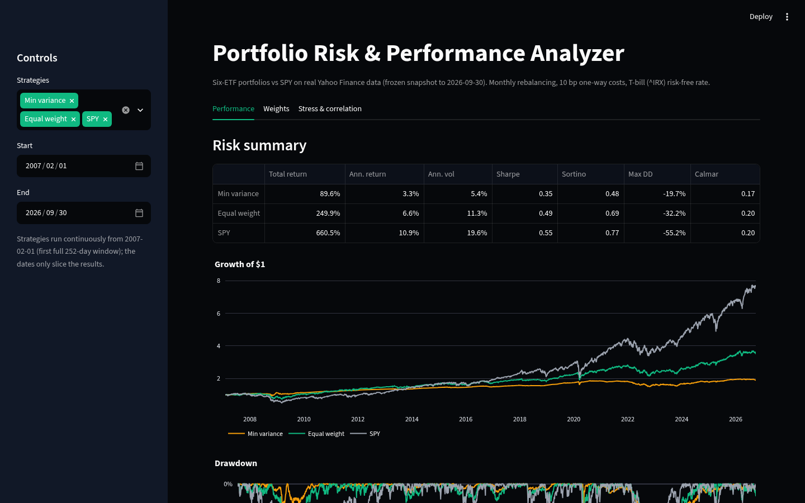
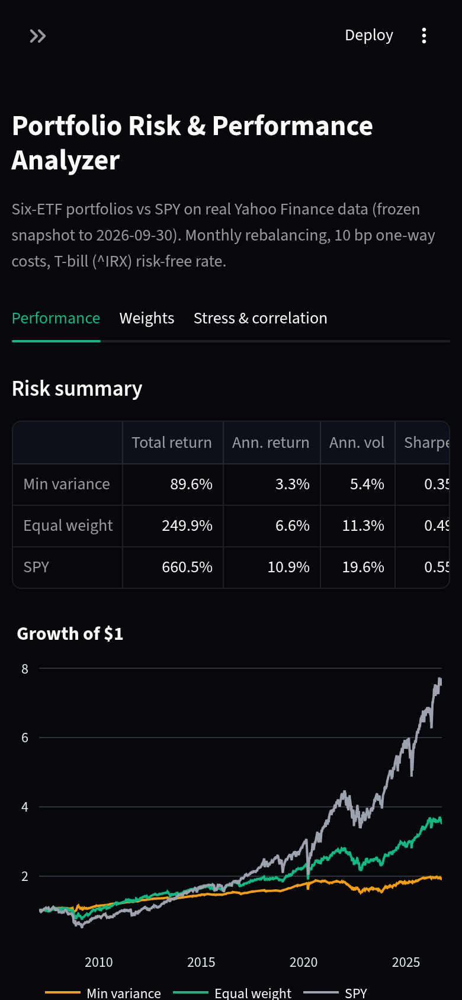
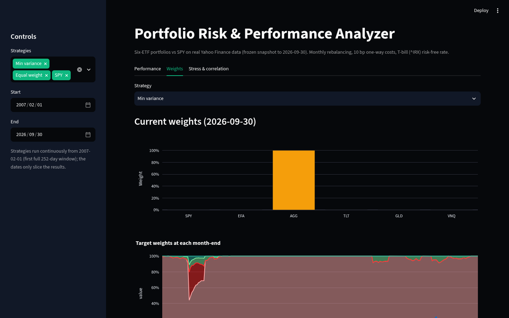
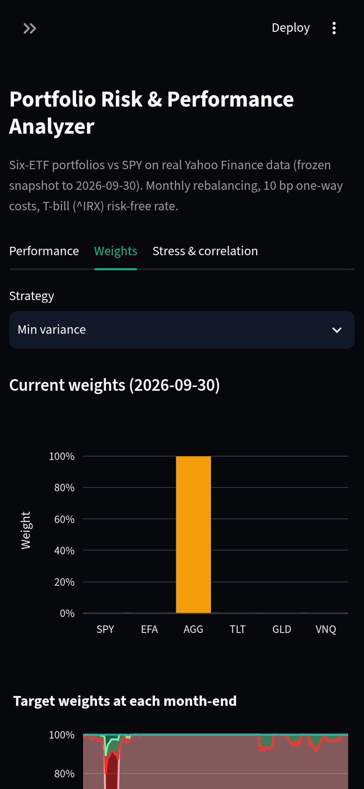
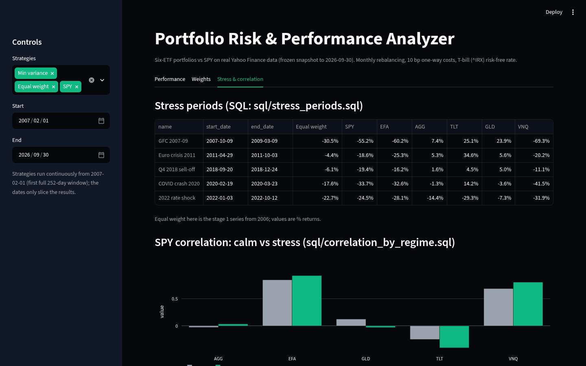
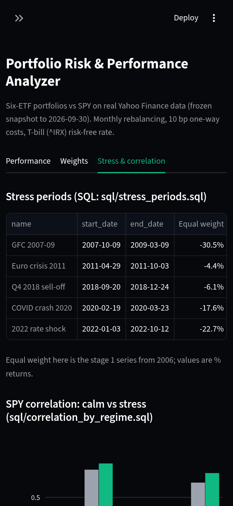

# Portfolio Risk & Performance Analyzer

**Research question:** how does a diversified ETF portfolio compare with an equity benchmark (SPY) in return, risk and drawdowns?

**Short answer, from this data:** over 2006–2026, an equal-weight six-ETF portfolio cut volatility by about 42% and the worst drawdown from −55% to −32%, at the cost of about 4 percentage points of return a year. Its Sharpe ratio was roughly the same as SPY's (0.52 vs 0.55). A minimum-variance portfolio lowered risk further, but it ended up mostly in bonds and had the *lowest* Sharpe of the three. Diversification bought lower risk, not better risk-adjusted return.

Python · pandas · NumPy · SQLite · Plotly · Streamlit · pytest · ruff · MIT license. Real data only; no number in this README is invented, and each one cites the results file it comes from.


---

## Contents
1. [Setup](#setup)
2. [Data](#data)
3. [Methodology](#methodology)
4. [Findings](#findings)
5. [Limitations](#limitations)
6. [Dashboard and screenshots](#dashboard-and-screenshots)
7. [Tests](#tests)
8. [Interview talking points](#interview-talking-points)
9. [How to defend this project](#how-to-defend-this-project)
10. [Project layout](#project-layout)

---

## Setup
```bash
git clone https://github.com/ParBproject/portfolio-risk-performance-analyzer
cd portfolio-risk-performance-analyzer
python -m venv .venv && . .venv/bin/activate
make install      # pip install -e ".[dev]"
make all          # recompute every results file, build SQLite, run all SQL, ruff, pytest
make app          # Streamlit dashboard at http://localhost:8501
make coverage     # pytest with a coverage report
```
`make all` needs no network. It verifies the frozen snapshot in `data/raw/` against the SHA-256 hashes in `data/manifest.json` and fails if any file has changed. `make data` re-downloads from Yahoo, which changes the hashes and therefore the results.

## Data
| | |
|---|---|
| Source | Yahoo Finance via `yfinance` (`auto_adjust=False`), downloaded 2026-10-23 (`data/manifest.json`) |
| Range | 2006-01-03 to 2026-09-30, 5,218 trading days per ETF (`results/sql/coverage.csv`) |
| Universe | SPY (US large-cap equity), EFA (developed ex-US equity), AGG (US aggregate bonds), TLT (long Treasuries), GLD (gold), VNQ (US REITs) |
| Risk-free | 13-week T-bill yield `^IRX`, ÷100 ÷252 per day; it averaged 1.69% a year (`results/stage1.json`) |

- **Dividends and splits:** returns are calculated from `Adj Close`, which Yahoo back-adjusts for splits and cash distributions. They are therefore *total* returns, which matters a great deal for bond and REIT ETFs. The raw `Close` is kept in SQLite for comparison.
- **Missing values:** prices are aligned to SPY's calendar. Gaps of up to 3 days are forward-filled (a stale price counts as a zero return), and longer gaps are dropped rather than invented. This snapshot had **0** missing values (`results/stage1.json`, `cleaning`).
- **Validation:** dates must be sorted and unique, prices must be positive with no NaNs left after cleaning, and no daily move may exceed 25%. A test checks that adjusted prices sit below raw prices for dividend payers.

## Methodology
**Stage 1: equal weight vs SPY.** Each ETF gets 1/6 of the portfolio. Weights drift with prices and are reset on the last trading day of every month. Costs are **10 bp one-way × turnover** at each rebalance, plus 10 bp on the initial purchase. SPY is buy-and-hold with no cost.

**Stage 2: SQL layer.** Tables `assets`, `prices`, `risk_free`, `strategy_returns` and `stress_periods`; views `v_returns`, `v_monthly`, `v_annual` and `v_drawdown`; 11 queries in `sql/`. `make sql` runs every query and saves the output to `results/sql/*.csv`. The SQL results are tested against independent pandas calculations.

**Stage 3: metrics** (`src/prpa/metrics.py`). All metrics use simple daily returns and 252 trading days a year.
| Metric | Definition |
|---|---|
| Annualised return | geometric: (1 + total)^(252/n) − 1 |
| Annualised vol | sample std of daily returns × √252 |
| Sharpe | mean(daily r − rf) ÷ std(daily r − rf) × √252 |
| Sortino | mean excess ÷ √mean(min(excess, 0)²) × √252 (downside averaged over all days) |
| Max drawdown | min of wealth ÷ running peak − 1 (starting $1 counts as a peak) |
| Calmar | annualised return ÷ \|max drawdown\| |
| Beta | cov(r, SPY) ÷ var(SPY) |
| Rolling | 252-day return, Sharpe and correlation; 63-day vol |

**Stage 4: minimum variance.** At each month-end close, weights are re-estimated from the sample covariance of the **trailing 252 daily returns only** (a standard window, not tuned). The portfolio is long-only and fully invested, and the solve is exact: every one of the 63 asset subsets is tried. Weights are applied from the **next** trading day, with the same 10 bp costs. All three strategies are compared over the same dates, 2007-02-01 to 2026-09-30, after the first full estimation window.

**Stage 5: dashboard.** Strategy selector, date filter, weights (current and over time), growth, drawdown, rolling Sharpe, risk table, and the stress and correlation views read from the SQL results.

**Stage 6: test audit.** Corrupted-input, manifest, schema, edge-case and end-to-end reproduction tests, with coverage reporting.

## Findings
### 1. Equal weight vs SPY, 2006-01-04 to 2026-09-30 (`results/stage1.json`, `results/stage3.json`)
| | Equal weight | SPY |
|---|---|---|
| Total return | 312.0% | 778.8% |
| Annualised return | 7.08% | 11.07% |
| Annualised vol | 11.11% | 19.20% |
| Sharpe | 0.52 | 0.55 |
| Sortino | 0.73 | 0.78 |
| Max drawdown | −32.2% | −55.2% |
| Calmar | 0.22 | 0.20 |
| Beta vs SPY | 0.47 | 1.00 |

- Both drawdowns bottomed on 2009-03-09. The portfolio's correlation with SPY was 0.81.
- Average monthly turnover was 2.5%, and total cost drag was about 0.73% over 20 years (`results/stage1.json`).
- SPY's daily correlation with each ETF: EFA 0.88, VNQ 0.74, GLD 0.07, AGG 0.00, TLT −0.30 (`results/stage1.json`). Bonds and gold did the diversifying; international stocks and REITs did not.

### 2. When diversification helped, and when it didn't (`results/sql/`)
- **Up and down months** (`monthly_hit_rate.csv`): the portfolio beat SPY in 39.8% of 249 months. That was 74.4% of SPY's 82 down months but only 22.8% of its 167 up months.
- **Calendar years** (`annual_summary.csv`): it beat SPY in 8 of 21 years (2026 is January to September only), including 2008 (−13.6% vs −36.8%). It trailed by 31.7 points in 2013. Its volatility was below SPY's in every year.
- **Stress windows** (`stress_periods.csv`):

| Window | Equal weight | SPY | TLT | AGG |
|---|---|---|---|---|
| GFC 2007-10-09 → 2009-03-09 | −30.5% | −55.2% | +25.1% | +7.4% |
| Euro crisis 2011 | −4.4% | −18.6% | +34.6% | +5.3% |
| Q4 2018 sell-off | −6.1% | −19.4% | +4.5% | +1.6% |
| COVID 2020-02-19 → 2020-03-23 | −17.6% | −33.7% | +14.2% | −1.3% |
| 2022 rate shock | −22.7% | −24.5% | −29.3% | −14.4% |

- **The 2022 exception:** in the rate shock, bonds fell with stocks, so diversification barely helped (−22.7% vs −24.5%).
- **Stock–bond correlation** (`stock_bond_corr_by_year.csv`): SPY–TLT was negative every year from 2007 to 2021 and positive every year from 2022 to 2026 (0.36 in 2026 so far).
- **Crisis correlations** (`correlation_by_regime.csv`): in stress windows, SPY's correlation rose to 0.93 with EFA (0.85 in calm periods) and to 0.80 with VNQ (0.69). Equity diversification weakens exactly when it is needed.
- **Drawdown duration** (`drawdown_episodes.csv`): SPY needed 1,777 days to recover from its 2007–09 drawdown, while the portfolio needed 667 days from its 2008–09 drawdown. In 2022, though, the portfolio took *longer* to recover than SPY (924 vs 710 days).
- **Rolling volatility** (`rolling_vol_summary.csv`): 63-day volatility averaged 9.7% for the portfolio vs 16.5% for SPY, and peaked at 41.6% vs 74.3% in December 2008.

### 3. Rolling 1-year view (`results/stage3.json`)
- Across 4,966 rolling 1-year windows, the portfolio beat SPY on return in 33.2% of them and on Sharpe in 46.4%.
- It lost money in 15.0% of windows, against 17.0% for SPY.
- Worst 1-year return: −28.7% for the portfolio vs −47.4% for SPY. Best: +44.3% vs +77.5%.
- The rolling correlation with SPY ranged from 0.32 (window ending 2017-12-14) to 0.92 (ending 2008-10-30).

### 4. Minimum variance vs equal weight vs SPY, 2007-02-01 to 2026-09-30 (`results/stage4.json`, `results/stage4_weights.csv`)
| | Min variance | Equal weight | SPY |
|---|---|---|---|
| Annualised return | 3.31% | 6.59% | 10.89% |
| Annualised vol | 5.38% | 11.26% | 19.58% |
| Sharpe | 0.35 | 0.49 | 0.55 |
| Sortino | 0.48 | 0.69 | 0.77 |
| Max drawdown | −19.7% | −32.2% | −55.2% |
| Calmar | 0.17 | 0.20 | 0.20 |
| Beta vs SPY | 0.09 | 0.47 | 1.00 |
| Avg monthly turnover | 3.7% | 2.6% | none |
| Total cost drag | 0.97% | 0.71% | none |

- **Mostly bonds:** minimum variance averaged **88.2% AGG**, with about 2.6 holdings above 1% at a time. The latest estimate (2026-09-30) is 100% AGG.
- **Lowest risk, worst risk-adjusted return:** it had the lowest volatility and drawdown, but also the lowest Sharpe of the three. Its worst drawdown came in 2022, not 2008.
- **Costs aren't the reason:** turnover was higher than equal weight's (its largest single rebalance was 95.8%), but costs were about 5 bp a year and don't explain the gap.

## Limitations
- **One historical path.** These are 20 years of one market history (falling rates until 2021, then the 2022 shock). It is not a forecast, and none of the Sharpe differences has been tested for statistical significance. With 0.52 vs 0.55, the difference is very likely noise.
- **Survivorship and selection.** All six ETFs survived. The universe was chosen for asset-class coverage, but with hindsight about which ETFs exist.
- **Data quality.** Yahoo is free, unaudited and revises adjusted history, which the frozen snapshot guards against. `^IRX` is a discount yield, used as an approximation.
- **Simple costs.** Costs are a flat 10 bp one-way, with no bid-ask modelling, market impact, taxes or fund-fee differences (ETF expense ratios are already in the prices). SPY carries no trading cost in the comparison.
- **Estimation risk.** The minimum-variance weights rest on a noisy 1-year sample covariance. No shrinkage or weight caps were applied, by design (no tuning).
- **Stress windows** are fixed, approximate SPY peak-to-trough dates, so they are SPY-centric by construction. Correlations are descriptive.
- **Dashboard dates slice** continuously run strategies rather than restarting them.

## Dashboard and screenshots
`make app` opens the dashboard. The sidebar has a strategy selector and date filters, and there are three tabs: **Performance** (risk table, growth of $1, drawdown, rolling Sharpe), **Weights** (current weights and month-end weights over time) and **Stress & correlation** (SQL stress windows, calm vs stress correlations, stock–bond correlation by year, ETF heatmap). The theme is dark/emerald, and the layout works on phones.

| | Desktop | Mobile |
|---|---|---|
| Performance |  |  |
| Weights |  |  |
| Stress & correlation |  |  |

## Tests
`make all` runs ruff and pytest; `make coverage` adds a coverage report. The suite includes:
- hand-checked metric cases (for example, +20% then −25% gives a −25% drawdown, and a 2-asset minimum-variance case with vols of 10% and 20% gives 0.8/0.2);
- no-lookahead tests for both backtests and the weight estimates;
- SQL-vs-pandas checks for every view and query;
- data validation (hashes, manifest fields, schema constraints, a one-byte corruption, injected negative prices and duplicate dates, gap handling);
- dashboard helpers plus a Streamlit `AppTest` smoke test;
- an end-to-end test that regenerates every results file and requires a byte-for-byte match;
- `tests/test_readme.py`, which checks that headline numbers in this README match the results files.

The audit found two real edge-case bugs, both now fixed: Sharpe returned about 1e16 for constant returns, and a target weight missing an asset slipped past validation.

## Interview talking points
1. **The question and the honest answer.** "Diversification cut volatility by about 42% and the worst drawdown by about 23 points, but Sharpe was roughly unchanged. The benefit was risk reduction, not better risk-adjusted return."
2. **Total returns.** "I used split- and dividend-adjusted closes. With raw closes, AGG's and VNQ's returns would be badly understated, because most of their return is income."
3. **Reproducibility.** "The data is a frozen snapshot with SHA-256 hashes, and a test regenerates every results file and requires an exact match. Anyone can reproduce every number offline."
4. **No lookahead.** "Minimum-variance weights use only the 252 days up to each month-end and apply from the next day. A test scrambles future returns and checks the past weights don't change."
5. **No tuning.** "The 252-day window, monthly rebalancing and 10 bp costs were fixed up front. I never tried alternatives to get a better number."
6. **Why minimum variance disappointed.** "It concentrates in the lowest-volatility asset, AGG at about 88% on average, so it's a bond fund with a small equity sleeve. Lowest volatility doesn't mean best Sharpe, and its worst drawdown was 2022, when bonds were the risk."
7. **Regime dependence.** "The stock–bond correlation was negative every year from 2007 to 2021 and positive every year from 2022 to 2026. A 60/40-style hedge that worked for 15 years stopped working, which is why I'd stress-test any allocation rather than trust full-sample correlations."
8. **SQL skills.** "Window functions for rolling vol, running peaks and drawdown episodes; compounding with exp(sum(ln(1+r))); Pearson correlation written out from sums. All of it is tested against pandas."
9. **Engineering.** "A tested metrics module shared by the analysis, the dashboard and the README; 97% test coverage; a UI smoke test."

## How to defend this project
- **"Your Sharpe difference is tiny, so is anything significant?"** No, and I don't claim it is. I report it as roughly equal. The robust findings are about risk: lower volatility, smaller drawdowns, and the 2022 failure of the bond hedge.
- **"Isn't the asset list cherry-picked?"** It's one ETF per major asset class, all with history back to 2006 so the sample includes 2008. Survivorship is listed as a limitation, and I didn't add or drop assets after seeing results.
- **"Why 252 days and monthly rebalancing?"** They are the standard defaults: one trading year and the most common institutional rebalance frequency. I deliberately didn't search over them, because the best of many windows would be overfit.
- **"Are costs realistic?"** 10 bp one-way is conservative for liquid ETFs. Even so, total drag was under 1% over the period, so the conclusions don't depend on the cost assumption.
- **"How do I know the numbers are right?"** Every metric has hand-calculated tests, the SQL is cross-checked against pandas, a corrupted byte fails the hash check, and the results files regenerate exactly from the frozen data.
- **"What would you do next?"** Bootstrap or Jobson–Korkie tests on the Sharpe difference, covariance shrinkage (Ledoit–Wolf), risk parity, out-of-sample regime analysis, and a realistic bid-ask cost model. I would present each as a new experiment, not a fix to make results look better.

## Project layout
```
src/prpa/      config, ingest, clean, db, metrics, portfolio, optimize,
               analysis (stage 1), stage3, stage4, dashboard (app helpers)
sql/           schema.sql, views.sql, 11 analysis queries
scripts/       run_queries.py (runs every query -> results/sql/)
data/raw/      frozen Yahoo CSVs (+ data/manifest.json with SHA-256)
results/       stage1.json, stage3.json, stage4.json, stage4_weights.csv, sql/*.csv
app/           streamlit_app.py
tests/         metrics, portfolio, data, SQL layer, min variance, dashboard, audit, README
docs/          screenshots
```

## License
MIT. See [LICENSE](LICENSE).
